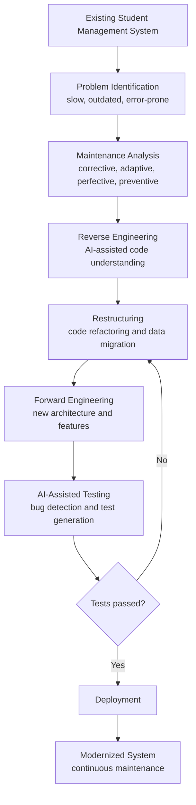

# Software Maintenance, Reengineering, and AI in Software Engineering

**Name:** Varun
**USN:** NB25CSE400
**Assigned Case Study:** Question 5 – Software Maintenance, Reengineering, and AI in Software Engineering (Student Management System)

---

## 1. Introduction

**Software maintenance** is the process of modifying a software system after delivery to correct faults, improve performance, add features, or adapt it to a changing environment. Studies commonly show that maintenance consumes more than half of a system's total lifecycle cost.

When maintenance alone is no longer enough, **software reengineering** restructures and rebuilds the system (code, design, data, and architecture) without changing what it fundamentally does for the user.

**AI-assisted software engineering** uses machine learning and large language models to help developers understand code, generate tests, find bugs, and write documentation faster.

---

## 2. Problem Analysis

A college has used its **Student Management System (SMS)** for several years. It now shows the following problems:

| # | Problem in existing system | Likely root cause |
|---|----------------------------|-------------------|
| 1 | Slow response (reports, search, result display) | Unoptimized database queries, missing indexes, old hardware or platform |
| 2 | Outdated features (no online fee payment, no mobile access, old UI) | Original design did not anticipate new user needs |
| 3 | Frequent errors and crashes | Accumulated bugs, patch-on-patch changes, poor code structure |
| 4 | Hard to modify | Poor or missing documentation, tightly coupled (monolithic) code |
| 5 | Compatibility and security risks | Old libraries, OS and database versions that are no longer supported |

---

## 3. Proposed Solution

### 3.1 Suitable Types of Software Maintenance

| Type | Meaning | Application to the SMS |
|------|---------|------------------------|
| **Corrective** | Fixing defects found in operation | Fix crashes and wrong results in marks, attendance, or fee calculation |
| **Adaptive** | Adjusting software to a changed environment | Upgrade to a supported OS, database, and browsers; adapt to new university or exam rules |
| **Perfective** | Improving performance and adding features | Speed up queries, add online fee payment, improve the UI, add mobile access |
| **Preventive** | Improving structure to avoid future faults | Refactor code, add documentation, add automated tests, update vulnerable libraries |

For this case, **corrective** (stop the errors), **perfective** (slow speed and outdated features), and **preventive** maintenance (future quality) are the most important. **Adaptive** maintenance supports them when the platform changes.

### 3.2 Steps in Software Reengineering

1. **Inventory analysis:** list the modules of the SMS (admission, attendance, marks, fees, reports) and rank them by business value and maintenance cost.
2. **Document restructuring:** create or update documentation, such as the data dictionary, module descriptions, and user manuals.
3. **Reverse engineering:** analyse the existing code and database to recover design and architecture (class, ER, and dependency diagrams).
4. **Code restructuring:** clean up and refactor the code, removing duplicate and dead code and improving naming and modularity, without changing behaviour.
5. **Data restructuring:** clean, normalize, and migrate the database to a modern schema or DBMS.
6. **Forward engineering:** rebuild or modernize the system with a modern architecture (for example web and mobile front end, REST APIs, and a cloud-hosted database), adding the new features.
7. **Testing and deployment:** run regression, integration, and user-acceptance tests, then roll out in stages and train users.

### 3.3 Two Applications of AI in Software Engineering

1. **AI-assisted code review, bug detection, and refactoring.**
   AI tools (such as GitHub Copilot or Claude Code, and static analysis tools with ML) scan the legacy code to find likely bugs, security weaknesses, and code smells. They suggest fixes and refactorings. They can also explain unfamiliar legacy code, which speeds up reverse engineering.

2. **AI-based test generation and documentation.**
   AI generates unit and regression test cases from existing code and requirements. It also produces missing documentation and comments automatically. This gives a safety net during reengineering and reduces repeat errors.

*(Other uses: defect prediction, automatic code migration, and chatbots for student queries.)*

### 3.4 Modernization Workflow Diagram

---

## 4. Benefits and Challenges

### Expected Improvements

1. **Better performance:** optimized database and code give faster searches, reports, and result processing.
2. **Higher quality and reliability:** fewer errors and crashes, thanks to bug fixes, refactoring, and automated testing.
3. **Modern features and easier maintenance:** online and mobile access, a better UI, and modular, documented code that is cheaper to change in the future.

### Challenges

- **Cost and time:** reengineering needs investment and skilled staff.
- **Risk to data and operations:** data migration errors or downtime could affect records and exams.
- **Limits of AI:** AI suggestions can be wrong or insecure, so they must be reviewed by developers. Sensitive student data must also be protected when AI tools are used.
- **Resistance to change:** staff may need training on the new system.

---

## 5. Conclusion

The Student Management System can be modernized with a combination of **maintenance** (to fix errors and keep the system current), **reengineering** (to rebuild its structure, data, and architecture), and **AI-assisted engineering** (to speed up code analysis, bug finding, and testing). Applied together, they make the system faster, more reliable, and easier to maintain, giving the college a long-lasting platform for managing student data.
