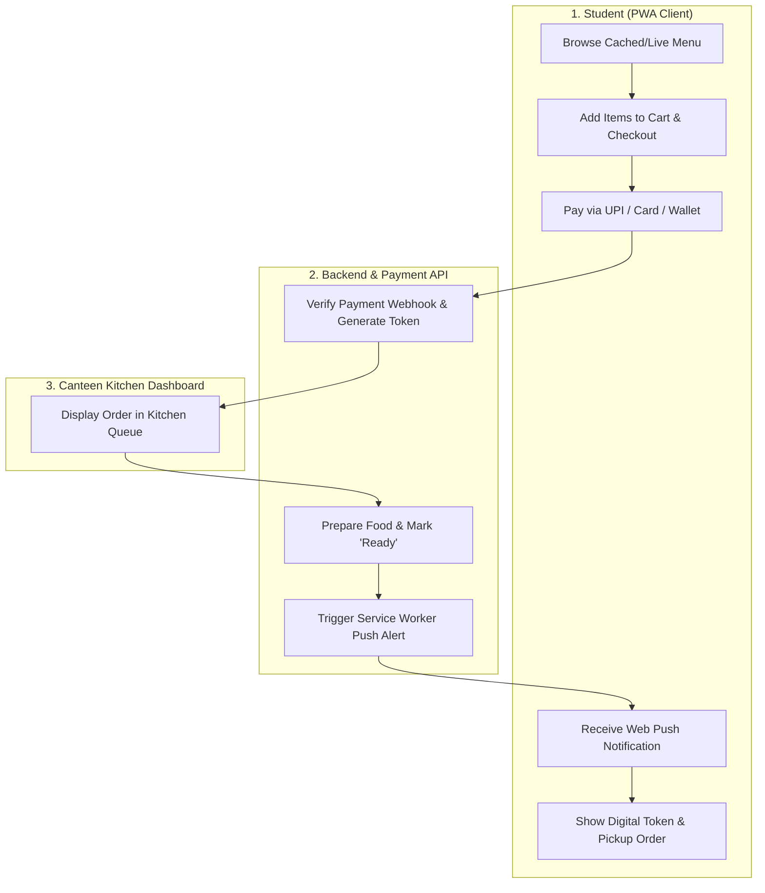

# Question 2: Mobile and Web Applications Engineering — Online Canteen Food-Ordering System

**Student Details:**
* **Name:** Vijayraj Devarumath
* **USN:** NB25CSE404
* **Assigned Case Study:** Question 2 — Mobile and Web Applications Engineering
* **Target File:** `contributions/NB25CSE404_Canteen_Application.md`

---

## 1. Introduction to Mobile and Web Applications

Modern software engineering relies heavily on client-server architectures delivered through web and mobile platforms:
* **Web Applications** run inside standard web browsers using HTML, CSS, and JavaScript, offering instant access across operating systems without installation.
* **Native Mobile Applications** are built specifically for platforms such as Android or iOS, providing deep access to device hardware, local offline storage, and native push notifications.
* **Progressive Web Applications (PWAs)** bridge these two paradigms by utilizing modern browser APIs—such as **Service Workers** and **Web App Manifests**—to deliver an app-like experience (including home-screen installation, offline caching, and background push notifications) from a single web codebase.

---

## 2. Problem Analysis

In a typical college campus, canteen operations face severe congestion during short break intervals and lunch hours. Manual counter ordering leads to:
1. **Long physical queues** and wasted break time for students.
2. **Order miscommunication** and delayed kitchen preparation.
3. **Lack of real-time stock visibility**, causing students to wait in line only to discover an item is sold out.
4. **Cash-handling bottlenecks** at the billing counter.

To solve these operational inefficiencies, the college requires an online canteen food-ordering system capable of menu browsing, order placement, digital payment processing, and automated order-ready notifications across a diverse mix of student devices (Android, iOS, and laptops).

---

## 3. Comparison of Mobile, Web, and PWA Approaches

| Evaluation Criterion | Native Mobile App | Traditional Web App | Progressive Web App (PWA) |
| :--- | :--- | :--- | :--- |
| **Installation & Access** | Requires downloading and installing from Google Play Store or Apple App Store. | Instant access via any browser URL; no installation required. | Instant browser access plus optional one-tap installation to the home screen. |
| **Cross-Platform Reach** | Requires separate codebases (Kotlin/Swift) or cross-platform frameworks. | Runs uniformly on Android, iOS, Windows, and macOS browsers. | Single unified codebase runs across all mobile and desktop platforms. |
| **Push Notifications** | Full native support via Firebase Cloud Messaging (FCM) or APNs. | Limited; typically relies on active browser tabs, SMS, or email alerts. | Supported via **Web Push API** and **Service Workers** even when closed. |
| **Offline & Low-Network Resilience** | Strong offline caching using local SQLite or Realm databases. | Fails or displays browser error screens when campus Wi-Fi drops. | Caches static assets and menus via Service Workers for weak connectivity. |
| **Development & Maintenance Cost** | High cost due to multi-platform builds, store fees, and review cycles. | Low cost; instant server-side updates without app store approval. | Low-to-moderate cost; single codebase with instant background updates. |

---

## 4. Proposed Solution: Selection & Justification

### Selected Architecture: Progressive Web Application (PWA)

A **Progressive Web Application (PWA)** is the most suitable architectural choice for the college canteen food-ordering system.

**Justification:**
1. **Zero-Friction Adoption:** Students can scan a QR code at the canteen or open a campus link to order immediately without downloading a large binary or consuming phone storage.
2. **Native-Like Order Alerts:** Unlike a standard website, a PWA uses Service Workers and the Web Push API to send real-time *"Order Ready"* notifications directly to a student's lock screen.
3. **Resilience in Campus Dead Zones:** Service Worker caching allows students to browse cached menus even when campus Wi-Fi or mobile data fluctuates.
4. **Cost-Effective Maintenance:** The college IT team maintains a single responsive codebase, bypassing App Store/Play Store publishing fees and multi-day review delays.

### 4.1 Four Major Functionalities

1. **Dynamic Menu Browsing & Live Availability:** Categorizes items (breakfast, lunch, snacks, beverages) with prices, preparation times, and real-time stock indicators updated by canteen staff.
2. **Cart Management & Order Placement:** Allows students to customize quantities, add preparation notes, review itemized totals, and generate a unique digital pickup token.
3. **Integrated Digital Payment Gateway:** Supports cashless checkout via UPI, cards, and campus wallets, verifying transactions via secure webhooks before dispatching orders to the kitchen.
4. **Real-Time Order Tracking & Push Notifications:** Tracks order states (`Placed` → `Preparing` → `Ready for Pickup` → `Completed`) and triggers automated Web Push notifications when food is ready at the counter.

### 4.2 Application Workflow Diagram

---

## 5. Benefits and Development Challenges

### Expected Benefits
* **Elimination of Queue Congestion:** Pre-ordering distributes kitchen workload evenly and removes physical billing queues.
* **Universal Accessibility:** Works seamlessly across Android, iOS, and desktop browsers from a single URL.
* **Accurate Inventory & Accounting:** Automated stock deduction and digital payment logs prevent overselling and cash discrepancies.

### Three Key Development Challenges
1. **Peak-Hour Traffic Concurrency & Inventory Race Conditions:** Hundreds of students order simultaneously at the start of lunch breaks. Without atomic database locking or optimistic concurrency control, two students could purchase the final portion of an item at the exact same millisecond.
2. **Cross-Browser Push Notification & iOS Safari Restrictions:** While Android Chrome supports Web Push natively, iOS Safari requires users to first add the PWA to their Home Screen before granting notification permissions—requiring fallback mechanisms like live in-app status polling or SMS alerts.
3. **Payment Gateway Webhook Latency & State Synchronization:** Network interruptions during UPI/card redirects can leave orders in a pending state, requiring idempotent payment webhooks and automated background reconciliation jobs.

---

## 6. Conclusion

Developing the college online canteen food-ordering system as a **Progressive Web Application (PWA)** delivers the ideal balance between instant student accessibility, native-like push notifications, and low institutional maintenance cost. By combining offline Service Worker caching, integrated digital payments, and automated kitchen workflows, the system resolves campus canteen congestion efficiently and reliably.