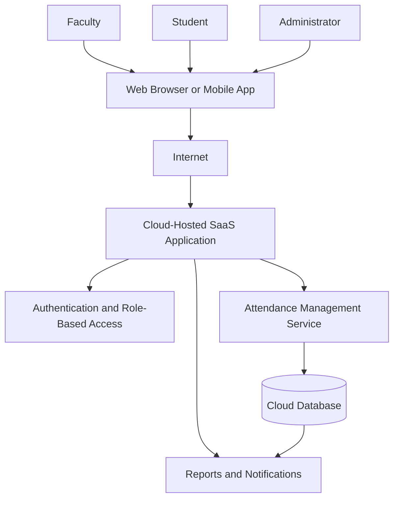
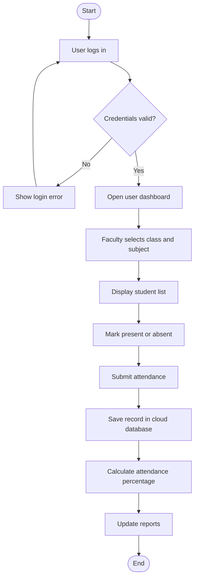
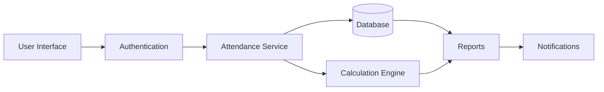
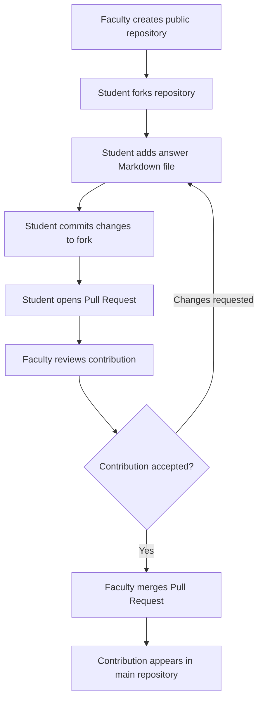

# SaaS-Based College Attendance Management System


## 1. Student and Case-Study Details

| Field | Details |
|---|---|
| Student name | Chandrashekar |
| USN | NB25CSE079 |
| Subject | Software Engineering |
| Selected question | Question 1 – SaaS and Cloud-Based Applications |
| Project title | SaaS-Based College Attendance Management System |
| GitHub contribution file | `contributions/NB25CSE079_SaaS_Attendance_System.md` |

---

## 2. Project Overview

The college currently maintains student attendance using paper registers and Excel sheets. This approach can make attendance tracking, report preparation, and information sharing time-consuming.

This project proposes a **Software as a Service (SaaS)** attendance management system. The application is hosted on cloud infrastructure and accessed through the internet using a web browser or mobile application. Faculty members can mark attendance from different locations, while authorized students and administrators can view attendance information.

### Main goals

- Replace manual attendance registers with digital attendance records.
- Keep attendance information in one centralized database.
- Allow authorized faculty to access the system from anywhere.
- Calculate attendance percentages automatically.
- Make attendance reports easier to prepare and share.
- Protect student information through access control and security measures.

## 3. What Is SaaS?

**Software as a Service (SaaS)** is a cloud computing model in which a software application is hosted by a service provider and made available to users over the internet.

Users generally access the application through a browser or app instead of installing and maintaining the complete system on their own computers. The provider manages the hosting environment and software updates.

### How SaaS applies to this project

1. The college subscribes to or deploys a cloud-hosted attendance service.
2. The administrator creates accounts for faculty members and students.
3. Faculty sign in and select a class and subject.
4. Faculty mark students as present or absent.
5. The application stores the attendance record in the cloud database.
6. The system calculates attendance and prepares reports.
7. Authorized users view the latest information through the application.

## 4. Problem Analysis

| Existing problem | Effect on the college | Proposed response |
|---|---|---|
| Paper registers and separate Excel files | Records can be difficult to organize and search | Centralized digital records |
| Manual percentage calculation | Takes time and may lead to calculation errors | Automatic attendance calculation |
| Sharing files between staff | Different copies may become inconsistent | Shared cloud-based information |
| Limited access to records | Faculty may not be able to check records away from campus | Secure access through the internet |
| Manual report preparation | Reports take additional time to prepare | Automatic daily and monthly reports |

## 5. Proposed System and Main Features

### Essential features

1. **Secure login:** Users sign in using authorized credentials.
2. **Role-based access:** Administrators, faculty, and students receive permissions appropriate to their roles.
3. **Student and class management:** Store student details, USN, semester, section, and subject information.
4. **Digital attendance marking:** Faculty select a class and mark each student present or absent.
5. **Automatic attendance calculation:** The system calculates attendance percentages for each student and subject.
6. **Reports and notifications:** Generate attendance reports and notify students when attendance is low.
7. **Centralized cloud database:** Store records in one location and make them available to authorized users.
8. **Backup and recovery:** Maintain backups so records can be restored after an accidental loss or system failure.

### Suggested attendance calculation

```text
Attendance Percentage =
(Number of classes attended / Total classes conducted) × 100
```

**Example:** If a student attends 36 out of 40 classes:

```text
(36 / 40) × 100 = 90%
```

This is an example calculation, not actual college attendance data.

## 6. System Architecture Diagram

The following diagram shows the proposed high-level architecture.



### Architecture explanation

- **Users:** Faculty, students, and administrators access the system.
- **Client application:** A browser or mobile app provides the user interface.
- **Internet:** Connects users to the hosted application.
- **SaaS application:** Processes attendance operations and application requests.
- **Authentication:** Checks user credentials and permissions.
- **Attendance service:** Handles class selection, attendance marking, and calculations.
- **Cloud database:** Stores student, subject, and attendance records.
- **Reports and notifications:** Presents attendance summaries and sends relevant updates.

## 7. Attendance Workflow Diagram



## 8. Benefits of Cloud-Based Access

1. **Access from anywhere:** Faculty can access attendance records from any location with an internet connection.
2. **Real-time information sharing:** Authorized users can view updated attendance after it is saved.
3. **Reduced maintenance effort:** The SaaS provider manages hosting, infrastructure, and software updates.
4. **Centralized records:** The college can manage attendance information in one system.
5. **Faster reporting:** Attendance summaries can be generated without manually combining multiple spreadsheets.
6. **Easier expansion:** The service can be scaled as the number of students, classes, or departments increases, depending on the provider's plan and system design.

## 9. Challenges and Possible Solutions

| Challenge | Why it matters | Possible solution |
|---|---|---|
| Internet dependency | Users may not be able to access the system during an outage | Provide reliable campus connectivity and a temporary backup procedure |
| Data security and privacy | Student details and attendance records must be protected | Use strong authentication, role-based permissions, encryption, and secure backups |
| Incorrect data entry | Attendance may be marked for the wrong class or student | Use confirmation screens, clear class lists, and audit logs |
| Service downtime | The application may temporarily become unavailable | Choose a provider with suitable availability and recovery arrangements |
| User training | Some staff may be unfamiliar with the application | Provide a short training session and a simple user guide |

## 10. Security Considerations

The system should include the following safeguards:

- Require individual accounts and strong passwords.
- Apply role-based access so users see only the information they need.
- Use HTTPS to protect information sent between the user's device and the service.
- Encrypt sensitive stored data where supported by the platform.
- Keep regular backups and test the restoration process.
- Maintain activity logs for important actions such as attendance changes.
- Deactivate accounts when users no longer need access.

## 11. Testing Plan

| Test area | Example test | Expected result |
|---|---|---|
| Login | Enter valid credentials | User reaches the correct dashboard |
| Login security | Enter an incorrect password | Access is denied |
| Attendance marking | Mark a student present | Attendance record is saved |
| Attendance calculation | Attend 36 of 40 classes | System displays 90% |
| Role permissions | Student tries to open an admin page | Access is denied |
| Report generation | Request a monthly report | Correct report is displayed |
| Backup and recovery | Restore a backed-up record set in a test environment | Records are recovered successfully |

## 12. Illustrative System Component Graph

This graph is a conceptual view of the main parts of the proposed system. It does not represent measured performance or actual usage.



## 13. Expected Outcomes

After implementation, the college can expect:

- Less dependence on paper registers and separate Excel files.
- Easier access to attendance records for authorized users.
- Faster attendance percentage calculation.
- More convenient report preparation.
- Better organization of student attendance information.
- Improved visibility of low attendance, subject to correct data entry and notification settings.

These are expected outcomes of the proposed design, not measured results from an implemented system.

## 14. Repository Structure

```text
SEA-Open-Source-Contributions/
│
├── README.md
│
└── contributions/
    └── NB25CSE079_SaaS_Attendance_System.md
```

## 15. GitHub Open-Source Contribution Workflow

The assignment requires each student to fork the faculty repository, add an individual Markdown contribution, commit the file, and submit a Pull Request.



### Submission steps

1. Sign in to the student's GitHub account.
2. Open the faculty repository and select **Fork**.
3. Open the forked repository.
4. Open the `contributions` folder.
5. Create or upload `NB25CSE079_SaaS_Attendance_System.md`.
6. Commit the change to the fork's `main` branch.
7. Select **Contribute → Open pull request**.
8. Check that the base repository is the faculty repository and the head repository is the student's fork.
9. Use a clear title, such as `Student Contribution – SaaS Attendance System`.
10. Create the Pull Request and share its URL as submission evidence.

## 16. Conclusion

A SaaS-based college attendance management system can replace manual registers and separate Excel sheets with a centralized digital solution. Faculty can mark attendance and access records from different locations, while students can view their attendance information when authorized. Automatic calculations and reports can reduce manual work. Internet dependency, data privacy, and service availability must be considered during implementation. With suitable security controls, reliable connectivity, and user training, SaaS is a suitable approach for the proposed attendance management system.

---

## References

- Unit 5 case-study question: **Question 1 – SaaS and Cloud-Based Applications**, from the provided *Unit 5 – Case Study Open Source Contribution Project* document.
- GitHub contribution procedure: the fork, commit, Pull Request, review, and merge workflow described in the provided assignment document.

## Contribution Note

This README describes the proposed system for an academic case study. The diagrams are conceptual, and the examples are illustrative. No real student records or attendance statistics are included.
