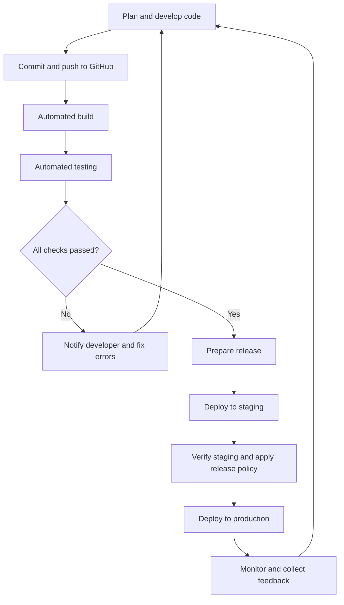

# Unit 5 Case Study – DevOps Practices and CI/CD Pipelines

| Student Details | Information |
|---|---|
| Name | Vishruth A M |
| USN | NB25CSE407 |
| Unit | 5 |
| Case Study | Question 3 – DevOps Practices and CI/CD Pipelines |

## 1. Introduction

DevOps is a software engineering approach that combines development (Dev) and operations (Ops) to improve collaboration, automate repetitive tasks and deliver reliable software efficiently. CI/CD is a key DevOps practice that automates the integration, testing and delivery of software changes.

## 2. Problem Analysis

A software company develops an online shopping application. Developers frequently update the application to introduce new features and fix bugs. However, manual testing and deployment cause delays and errors.

The major problems are:

- Time-consuming manual testing.
- Human errors during deployment.
- Delays in releasing new features and bug fixes.
- Risk of introducing defects into the existing shopping application.

## 3. Proposed Solution

The company can adopt DevOps practices and implement an automated CI/CD pipeline using GitHub for version control and GitHub Actions for automation. Developers collaborate through a shared repository, review code changes and use automated tests to verify application quality before release.

### Continuous Integration (CI)

Continuous Integration is the practice of frequently integrating code changes into a shared repository. Automated builds and tests verify changes and help identify defects early.

### Continuous Delivery and Continuous Deployment (CD)

- **Continuous Delivery:** Automatically prepares validated software for release. Production deployment may require manual approval.
- **Continuous Deployment:** Automatically deploys validated changes to production after all required checks pass, without manual approval.

### CI/CD Pipeline Stages

| Stage | Description |
|---|---|
| 1. Plan and Code | Developers plan features, fix bugs and write code. |
| 2. Commit | Changes are committed and pushed to GitHub. |
| 3. Build | The pipeline installs dependencies and builds or packages the application. |
| 4. Test | Automated tests verify functionality, integration and application quality. |
| 5. Release | A successfully tested build is prepared for deployment. |
| 6. Deploy | The application is deployed to staging, verified and then released to production according to the deployment policy. |
| 7. Monitor | Application performance, errors and user feedback are monitored to identify improvements. |

### Explanation of Build, Test and Deployment

**Build:** The source code is processed, dependencies are installed and a deployable application package is generated automatically.

**Test:** Automated unit and integration tests verify features such as user login, product search, shopping cart, checkout and order placement. If a required test fails, the pipeline stops and developers fix the issue before proceeding.

**Deployment:** The validated application is deployed to a staging environment for final verification. It is then deployed to production after approval (Continuous Delivery) or automatically after required checks pass (Continuous Deployment). A previous stable version can be restored if a release causes problems.

### CI/CD Pipeline Diagram

### Practical Example

Suppose a developer adds a discount coupon feature to the online shopping application. After the code is pushed to GitHub, the CI/CD pipeline automatically builds the application and runs tests to verify coupon validation, cart totals and checkout functionality. If the checks pass, the updated application can be released according to the deployment policy. If a test fails, deployment is blocked until the defect is corrected.

## 4. Benefits and Challenges

### Three Benefits of Automation

1. **Faster software delivery:** Automated builds, tests and deployments reduce release delays.
2. **Improved software quality:** Continuous testing identifies defects early and reduces deployment errors.
3. **Increased productivity:** Developers spend less time on repetitive manual tasks and more time developing features.

### Challenges

- **Initial setup and maintenance:** Configuring the pipeline and maintaining automated tests require time and technical expertise.
- **Security:** Deployment credentials and sensitive customer information must be protected through secure secret management and access controls.
- **Test coverage:** Incomplete automated tests may allow defects to reach production.

## 5. Conclusion

By adopting DevOps practices and implementing a CI/CD pipeline, the software company can automate the build, testing and deployment processes of its online shopping application. This reduces manual errors, improves software quality and enables faster, more reliable delivery of new features and bug fixes.
