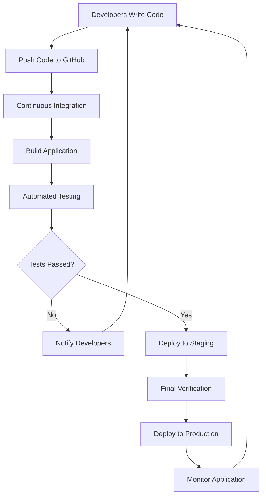

# Question 3: DevOps Practices and CI/CD Pipelines

## 1. Introduction to DevOps

DevOps is a combination of Development (Dev) and Operations (Ops). It is a software development approach that brings developers and IT operations teams together to improve collaboration, communication, and software delivery.

In an online shopping application, developers frequently introduce new features, fix bugs, and improve performance. DevOps practices help automate these activities, reduce manual work, and deliver software updates faster and more reliably.

## 2. Meaning of Continuous Integration and Continuous Delivery/Deployment

**Continuous Integration (CI):**

Continuous Integration is the practice of frequently merging code changes made by different developers into a shared repository. Every code change is automatically checked through building and testing to identify errors at an early stage.

**Continuous Delivery (CD):**

Continuous Delivery is the process of automatically preparing tested software for release. The application is always ready for deployment, but the final deployment to production usually requires manual approval.

**Continuous Deployment:**

Continuous Deployment automatically releases every code change that successfully passes all testing stages directly into the production environment without manual approval.

## 3. CI/CD Pipeline Stages

The CI/CD pipeline consists of the following stages:

1. **Code:** Developers write new code, fix bugs, and add features to the online shopping application. They push their changes to a GitHub repository.

2. **Build:** The system automatically compiles the source code, installs required dependencies, and creates an executable application package.

3. **Test:** Automated tests are performed to identify errors and verify that the application works correctly. Unit testing, integration testing, and functional testing are used.

4. **Deploy:** After successful testing, the application is deployed to a staging environment for further verification and then released to the production server.

5. **Monitor:** The deployed application is continuously monitored for errors, performance issues, and server problems. Feedback is used to improve future updates.

## 4. Explanation of Build, Test, and Deployment

**Build:**

The build stage converts the developer's source code into a usable application package. Dependencies are installed, and the code is compiled or packaged. If any build errors occur, the pipeline stops and notifies the developers.

**Test:**

The testing stage automatically checks whether the application functions correctly. For example, in an online shopping application, tests can verify user login, product searching, adding products to the cart, and payment processing. If errors are found, developers fix them before deployment.

**Deployment:**

The deployment stage releases the successfully tested application to the server. The updated version becomes available to customers. Deployment can be automated using tools such as GitHub Actions, Docker, and cloud platforms.

## 5. Three Benefits of Automation

1. **Faster Software Delivery:** Automation reduces manual work and speeds up building, testing, and deployment. New features and bug fixes can be delivered quickly.

2. **Reduced Errors and Improved Quality:** Automated testing identifies bugs early and reduces human errors during deployment, making the application more reliable.

3. **Better Collaboration and Productivity:** DevOps improves communication between development and operations teams. Developers can focus more on developing new features instead of performing repetitive tasks.

## 6. CI/CD Pipeline Diagram

The following diagram represents the automated CI/CD pipeline for the online shopping application.

## 7. Conclusion

DevOps practices and CI/CD pipelines help software companies automate the software development and deployment process. In an online shopping application, they make it easier to introduce new features, fix bugs, and release updates quickly. Automation reduces errors, improves software quality, increases productivity, and ensures faster and more reliable software delivery.

## Tools Used

- Git and GitHub – Version control and code management.
- GitHub Actions – Automating CI/CD workflows.
- Docker – Application containerization.
- Automated Testing Tools – Testing application functionality.
- Cloud Platforms – Hosting and deploying the application.
