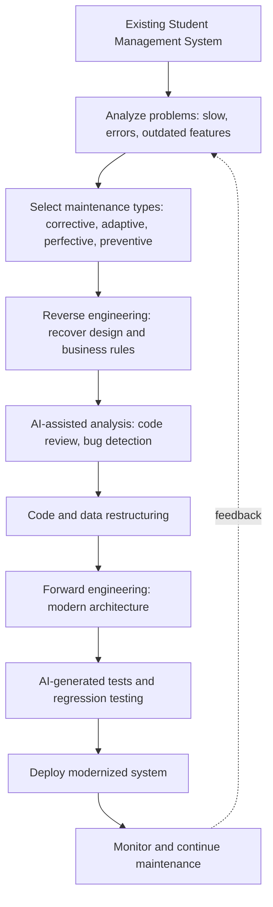

# Software Maintenance, Reengineering, and AI in Software Engineering

**Name:** Vrinda Rani M Bagali
**USN:** NB25CSE412
**Assigned Case Study:** Question 5 – Software Maintenance, Reengineering, and AI in Software Engineering
**Case:** Modernizing a Student Management System (SMS)

---

## 1. Introduction

**Software maintenance** is the process of modifying a software product after delivery to fix faults, improve performance, adapt it to a changing environment, or add new capabilities. Studies commonly show that maintenance consumes the largest share of a software system's total lifecycle cost, so keeping an old system healthy is as important as building it.

**Software reengineering** goes a step further. Instead of making small patches, it examines an existing system and restructures or rewrites parts of it so that it becomes easier to understand, maintain, and extend, without changing what the system is meant to do for its users.

**AI-assisted software engineering** uses machine learning and large language models to support tasks such as code review, bug detection, test generation, documentation, and code refactoring.

In this case study, a college has used a Student Management System for several years. It is now slow, has outdated features, and often produces errors. The goal is to apply maintenance, reengineering, and AI techniques to modernize it.

---

## 2. Problem Analysis

The following problems can be identified in the existing Student Management System:

| # | Problem | Likely Cause |
|---|---------|--------------|
| 1 | The system is slow | Unoptimized database queries, missing indexes, old hardware or outdated technology stack |
| 2 | Frequent errors and crashes | Accumulated bugs, poor error handling, patches layered on patches |
| 3 | Outdated features | No online fee payment, no mobile access, no dashboard or notification support |
| 4 | Hard to modify | Poor structure, tightly coupled modules, little or no documentation |
| 5 | Weak security | Old libraries with known vulnerabilities, weak authentication |
| 6 | Poor testing coverage | Changes are made without automated tests, so new bugs appear |

These symptoms show that the system suffers from **software aging**: its design and code have degraded over time while the needs of the college have kept changing.

---

## 3. Proposed Solution

### 3.1 Suitable Types of Software Maintenance

| Type | Meaning | Application to the Student Management System |
|------|---------|-----------------------------------------------|
| **Corrective maintenance** | Fixing defects found in the software | Fix errors in result calculation, attendance records, and login failures |
| **Adaptive maintenance** | Changing the software to suit a new environment | Upgrade to a newer operating system, database version, and browsers; support cloud hosting |
| **Perfective maintenance** | Improving performance and adding or enhancing features | Speed up searches, add a student dashboard, online fee payment, and report generation |
| **Preventive maintenance** | Making changes now to avoid future problems | Refactor messy code, update documentation, add automated tests, replace vulnerable libraries |

All four types are useful here. Corrective maintenance fixes the present errors, perfective maintenance addresses slowness and outdated features, adaptive maintenance keeps the system compatible with new technology, and preventive maintenance reduces future failures.

### 3.2 Steps Involved in Software Reengineering

1. **Inventory analysis:** List all modules of the system (admissions, attendance, marks, fees) and decide which ones need reengineering first, based on business value and maintenance cost.
2. **Document restructuring:** Update or create missing documentation such as requirements, database schema, and user manuals.
3. **Reverse engineering:** Study the existing code and database to recover the design, data flow, and business rules.
4. **Code restructuring:** Clean up the source code by removing duplicate code, simplifying complex logic, and following coding standards, without changing behavior.
5. **Data restructuring:** Redesign and normalize the database, clean inconsistent records, and migrate the data to a modern database.
6. **Forward engineering:** Rebuild or redesign parts of the system using modern architecture, for example a web-based modular design with a REST API and responsive user interface.
7. **Testing and deployment:** Test the new system against the old one to confirm that results match, then deploy in phases, with user training.

### 3.3 Applications of AI in Software Engineering

**Application 1: AI-assisted code analysis and refactoring**
AI code assistants can read the legacy code, explain what unclear functions do, point out duplicate or risky code, and suggest cleaner replacements. This speeds up reverse engineering and code restructuring, and helps new developers understand an old codebase. All suggestions must still be reviewed by a developer.

**Application 2: AI-based bug detection and automated test generation**
Machine learning tools can scan the code to predict where bugs are likely to be, detect security weaknesses, and automatically generate unit tests for existing functions. This reduces the errors that reach users and gives confidence while the system is being modified.

*(Other possible uses: automatic documentation generation, chatbot for student queries, and predicting students at risk using data analytics.)*

### 3.4 Modernization Workflow Diagram



Plain-text version of the same workflow:

```
Existing System -> Problem Analysis -> Choose Maintenance Types
   -> Reverse Engineering -> AI Code Analysis -> Restructure Code and Data
   -> Forward Engineering -> AI Test Generation + Testing
   -> Deployment -> Monitoring -> (back to Problem Analysis)
```

---

## 4. Benefits and Challenges

### Expected Improvements

1. **Better performance:** Optimized queries, a cleaner database, and modern architecture reduce loading time and let more users access the system at once.
2. **Higher reliability and quality:** Fixing defects and adding automated tests greatly reduces errors and crashes.
3. **Easier future maintenance and new features:** Clean, documented, modular code lets the college add features such as online payments or mobile access faster and at lower cost.

### Challenges and Limitations

- **Cost and time:** Reengineering needs effort, skilled developers, and a budget, and the old system must keep running during the transition.
- **Risk to existing data and behavior:** Data migration errors or lost business rules can cause wrong results if testing is not careful.
- **Limits of AI tools:** AI suggestions can be wrong or insecure, so they need human review. Student data must also be protected when using external AI services.
- **User resistance:** Staff used to the old system need training to adopt the new one.

---

## 5. Conclusion

The college's Student Management System can be improved by combining three approaches. **Software maintenance** (corrective, adaptive, perfective, and preventive) fixes current problems and keeps the system usable. **Software reengineering** restructures the code, data, and architecture so the system is easier to understand and extend. **AI-assisted tools** speed up code analysis, bug detection, and testing, and reduce human effort. Together they produce a faster, more reliable, and more maintainable system, as long as the work is done in planned phases, with careful testing and human review of AI output.
