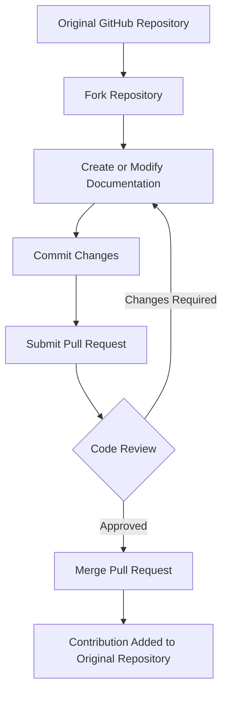

# Open-Source Software Engineering

**Name:** Manu Arunmozhy  
**USN:** [NB25CSE414]  
**Case Study:** Question 4 – Open-Source Software Engineering

## 1. Introduction

Open-source software engineering is the process of developing software whose source code is publicly available for users and developers to study, modify and improve.

It allows developers from different locations to collaborate on a common project. GitHub is a popular platform used to host open-source projects and manage contributions.

## 2. Problem Analysis

A group of developers has developed an open-source Library Management System hosted on GitHub. However, the project lacks proper documentation explaining how users can issue and return books.

Due to the absence of documentation, users may face difficulties understanding the system and performing basic library operations.

To solve this problem, a student can contribute by creating or improving the documentation of the project.

## 3. Proposed Solution

The student can improve the project documentation by following these steps:

### 3.1 Forking the Repository

Forking means creating a personal copy of an existing repository under the student's GitHub account.

The student visits the original Library Management System repository and clicks the Fork button. This creates a separate copy where the student can make changes without directly modifying the original project.

### 3.2 Creating or Modifying Documentation

The student creates a Markdown file named `Library_Documentation.md` in the forked repository.

The document explains the following operations:

**Issuing a Book:**
1. Log in to the Library Management System.
2. Search for the required book.
3. Check whether the book is available.
4. Select the issue book option.
5. Confirm the issue transaction.
6. Note the due date for returning the book.

**Returning a Book:**
1. Log in to the system.
2. Open the issued books section.
3. Select the book to be returned.
4. Click the return book option.
5. Confirm the return transaction.
6. Check whether any overdue fine is applicable.

### 3.3 Committing Changes

After creating the documentation, the student saves the changes by committing them to the forked repository.

A commit message such as `Added library issue and return documentation` describes the changes made.

### 3.4 Submitting a Pull Request

A Pull Request (PR) is a request to merge the changes from the student's fork into the original repository.

The student opens the Pull Requests section, creates a new Pull Request and provides a suitable title and description.

The original project developers review the changes. If the documentation is correct, they approve and merge the Pull Request into the original repository.

## 4. GitHub Contribution Workflow

The complete open-source contribution process is shown below:

## 5. Importance and Benefits of Open-Source Contributions

1. **Knowledge Sharing:** Developers can share their knowledge and improve existing software.
2. **Skill Development:** Students gain practical experience in software development and GitHub.
3. **Collaboration:** Developers from different locations can work together on a common project.
4. **Software Improvement:** Contributions help improve software quality, usability and documentation.
5. **Community Support:** Open-source projects encourage developers to help one another.

## 6. Challenges of Open-Source Contributions

1. **Understanding Existing Projects:** New contributors may find it difficult to understand the structure and working of an existing project.
2. **Code Review and Approval:** Contributions may require corrections or modifications before being accepted by the original developers.

## 7. Conclusion

Open-source software engineering encourages collaboration, knowledge sharing and continuous improvement of software projects.

By following the GitHub contribution workflow of forking a repository, creating documentation, committing changes and submitting a Pull Request, students can contribute to real-world software projects.

Improving the Library Management System documentation makes it easier for users to understand and perform book issuing and returning operations. This process also helps students develop practical software engineering and collaborative development skills.
