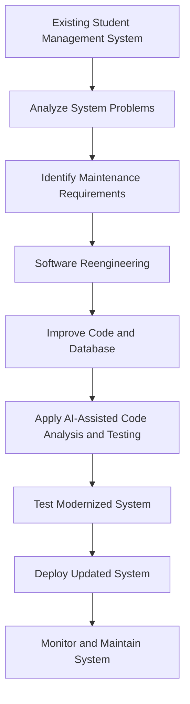

# Software Maintenance, Reengineering, and AI in Software Engineering

**Name:** vaibhav subash thundutharayil  
**USN:** [NB25CSE396]  
**Assigned Case Study:** Question 5 – Software Maintenance, Reengineering, and AI in Software Engineering

## 1. Introduction

Software maintenance is the process of modifying and updating software after its deployment to correct errors, improve performance, adapt to changing requirements, and maintain its usefulness.

Software reengineering involves examining and modifying an existing software system to improve its structure, quality, and maintainability without completely developing a new system.

AI-assisted software engineering uses artificial intelligence tools to support activities such as code analysis, debugging, testing, and software quality improvement.

## 2. Problem Analysis

The college's existing Student Management System has been used for several years. It now faces the following problems:

- **Slow performance:** The system takes a long time to process requests and retrieve student records.
- **Outdated features:** Some functions no longer meet the current requirements of students and college staff.
- **Frequent errors:** Bugs and software failures affect the reliability of the system.
- **Difficult maintenance:** Older code may be poorly structured or difficult to understand.
- **Poor user experience:** Delays and errors make the system difficult to use.

These problems affect the efficiency and reliability of student-related administrative activities.

## 3. Proposed Solution

### A. Suitable Types of Software Maintenance

1. **Corrective Maintenance:** Fix existing bugs, errors, and failures in the system.
2. **Adaptive Maintenance:** Modify the software to work with updated operating systems, databases, and other technologies.
3. **Perfective Maintenance:** Improve performance, usability, and existing features according to user requirements.
4. **Preventive Maintenance:** Improve code structure and remove potential weaknesses to reduce future failures.

### B. Steps in Software Reengineering

1. **System Analysis:** Examine the existing system, its source code, database, and functionality.
2. **Inventory Analysis:** Identify outdated, redundant, and problematic modules.
3. **Reverse Engineering:** Study the existing system to understand its design, architecture, and internal structure.
4. **Code Restructuring:** Improve the organization and readability of existing code.
5. **Data Restructuring:** Review and improve the database structure while preserving important student records.
6. **Forward Engineering:** Rebuild or modify the improved system with updated technologies and features.
7. **Testing and Deployment:** Test the modernized system and deploy it after verifying its correctness.

### C. Two Applications of AI in Software Engineering

1. **AI-Assisted Bug Detection and Code Analysis:** AI tools can analyze source code, identify possible errors, detect suspicious code patterns, and suggest corrections.
2. **Automated Software Testing:** AI-assisted tools can help generate test cases, identify areas requiring testing, and analyze test results to detect defects.

AI suggestions should be reviewed and verified by developers before implementation.

### D. Three Expected Improvements

1. **Improved Performance:** Faster processing and retrieval of student information.
2. **Better Reliability:** Fewer software errors and improved system stability.
3. **Enhanced Functionality:** Updated features and a better user experience for students and college staff.

## 4. Benefits and Challenges

### Benefits

- Reduces system errors and improves reliability.
- Extends the useful life of the existing software.
- Improves performance and maintainability.
- AI-assisted tools can reduce the effort required for debugging and testing.
- Modernized features improve the experience of students and staff.

### Challenges

- Reengineering old software can be complex and time-consuming.
- Modernization may require additional cost and technical expertise.
- Existing student data must be protected during migration.
- AI-generated suggestions may be incorrect and require human verification.
- System downtime must be minimized during deployment.

## 5. Simple Modernization Workflow Diagram

## 6. Conclusion

Software maintenance and reengineering help improve the performance, reliability, and usefulness of the existing Student Management System. Corrective, adaptive, perfective, and preventive maintenance address different system problems, while reengineering improves the internal structure of the software. AI-assisted code analysis and testing can further support software quality improvement. By combining these techniques, the college can modernize its existing system without unnecessarily replacing it completely.
