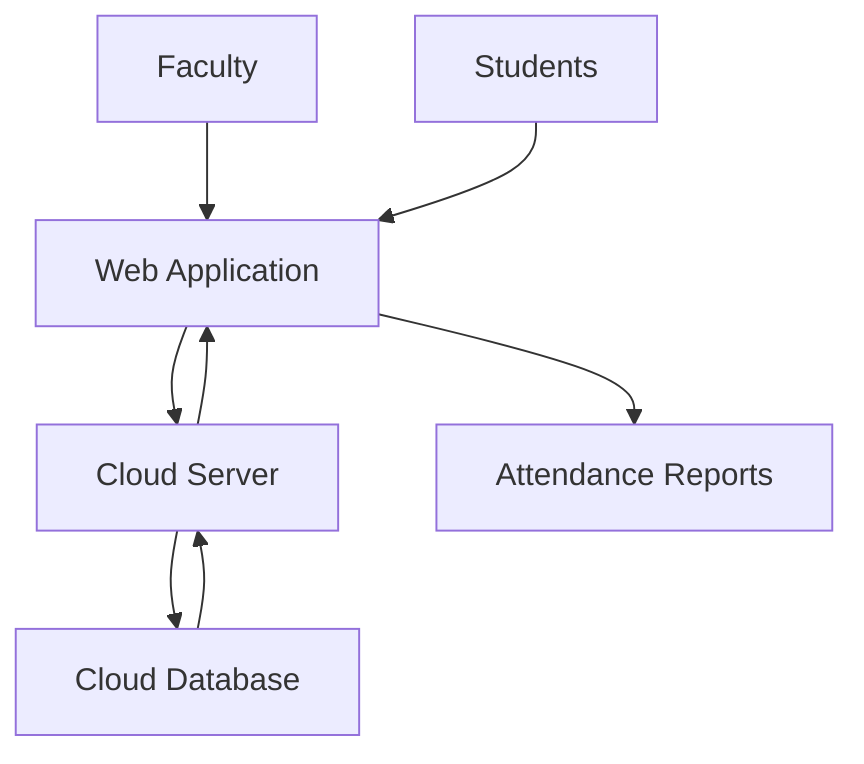

# SaaS-Based College Attendance Management System

## 1. Student Details

- **Name:** Sumit Kumar
- **USN:** 2604259
- **Subject:** Software Engineering
- **Case Study:** Q1 – SaaS and Cloud-Based Applications

## 2. Introduction to SaaS

Software as a Service (SaaS) is a cloud computing model in which software applications are provided over the internet. Users can access these applications through a web browser without installing them on their computers.

Examples: Google Drive, Microsoft 365 and online attendance systems.

## 3. Problem Analysis

Currently, the college maintains student attendance using registers and Excel sheets. This creates several problems:

- Manual attendance takes more time.
- Maintaining records is difficult.
- Errors may occur while calculating attendance.
- Faculty members cannot easily access records from different locations.
- Generating attendance reports becomes time-consuming.

## 4. Proposed Solution

The college can implement a cloud-based Attendance Management System using the SaaS model.

Faculty members can log in using their accounts and mark student attendance through a web browser. The attendance data will be stored securely on cloud servers.

Students can also log in to check their attendance records.

## 5. Essential Features

1. **User Login:** Faculty and students can securely log in using their accounts.
2. **Digital Attendance:** Faculty can mark student attendance online.
3. **Attendance Reports:** The system can automatically generate daily and monthly reports.
4. **Student Dashboard:** Students can check their attendance percentage and records.
5. **Data Storage:** Attendance records are stored in a cloud database.

## 6. Benefits of Cloud-Based Applications

1. **Anywhere Access:** Faculty and students can access the system from anywhere using the internet.
2. **Time Saving:** Digital attendance reduces manual work and paperwork.
3. **Easy Data Management:** Attendance records can be stored, updated and retrieved easily.

## 7. Challenges

1. **Internet Dependency:** The system requires a stable internet connection to access cloud services.
2. **Data Security:** Student information must be protected from unauthorized access and data leakage.

## 8. Simple Architecture Diagram

## 9. Conclusion

A SaaS-based Attendance Management System can make attendance management easier, faster and more efficient. It reduces paperwork, saves time and allows faculty and students to access attendance records from anywhere. Although internet dependency and data security are challenges, proper security measures and reliable cloud services can help overcome them.

**End of Contribution**
