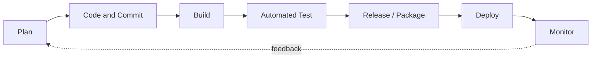

# Case Study 3: DevOps Practices and CI/CD Pipelines

**Name:** Sneha Pal
**USN:** NB25CSE352
**Assigned Case Study:** Question 3 – DevOps Practices and CI/CD Pipelines

## Introduction
DevOps is a software engineering culture and set of practices that brings development (Dev) and operations (Ops) teams together. Its aim is to deliver software faster, more reliably and with fewer errors by using collaboration, automation and continuous feedback.

**Continuous Integration (CI)** means developers merge their code changes into a shared repository frequently, and every merge automatically triggers a build and tests.

**Continuous Delivery (CD)** means every change that passes the tests is automatically prepared and kept ready for release, and a person approves the final deployment.

**Continuous Deployment** goes one step further: every change that passes all tests is released to production automatically, with no manual approval.

## Problem Analysis
A software company develops an online shopping application. Developers update it often to add features and fix bugs, but testing and deployment are done manually. This causes:
- Delays, because manual testing and release take a lot of time.
- Human errors, such as missed test cases, wrong configuration or a wrong version being deployed.
- Late bug detection, because code is integrated and tested only at the end.
- Poor coordination between developers and the operations team.

## Proposed Solution
Adopt DevOps practices and build an automated CI/CD pipeline that runs every time a developer pushes code.

### CI/CD Pipeline Diagram

### Pipeline Stages
1. **Plan:** Features and bugs are tracked as tasks (for example in Jira or GitHub Issues).
2. **Code and Commit:** Developers push code to a shared Git repository, using branches and pull requests.
3. **Build:** The pipeline automatically compiles the code, resolves dependencies and creates a build artifact, such as a Docker image.
4. **Test:** Unit tests, integration tests and security checks run automatically. If any test fails, the pipeline stops and the developer is notified.
5. **Release:** The tested artifact is versioned and stored in a registry, ready for deployment.
6. **Deploy:** The artifact is deployed first to a staging environment and then to production, using scripts or tools such as Jenkins, GitHub Actions, GitLab CI or Kubernetes.
7. **Monitor:** Logs, performance and errors are watched, and feedback goes back to the team for the next iteration.

### Build, Test and Deployment Explained
- **Build:** Converts source code into a runnable package. The same build process is used every time, so results are consistent.
- **Test:** Automated tests check that new changes do not break existing features, for example cart, payment and login in the shopping application.
- **Deployment:** The verified package is released with scripts, so no manual copying of files is needed. Rolling back to an earlier version is also quick if a problem appears.

## Benefits and Challenges
### Three Benefits of Automation
1. **Faster delivery:** Builds, tests and releases run automatically, so new features and bug fixes reach users sooner.
2. **Fewer errors:** Automated steps are repeatable and remove manual mistakes in testing and deployment.
3. **Early bug detection and better quality:** Every commit is tested, so problems are found and fixed early when they are cheaper to fix.

### Challenges
- Initial setup effort and cost of tools and infrastructure.
- Team needs training and a change in culture.
- Test suites must be written and maintained, otherwise automation gives a false sense of safety.
- Pipeline security, such as protecting secrets and access.

## Conclusion
Manual testing and deployment slow down the online shopping application and cause errors. Applying DevOps practices with a CI/CD pipeline (build, test, release, deploy and monitor) automates these steps. This gives faster releases, fewer mistakes and better software quality. Despite the setup effort and training needed, automation is a sound solution for a company that updates its application frequently.
