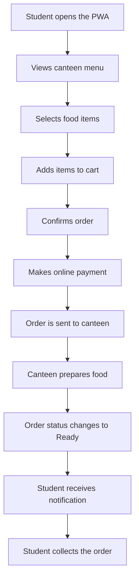

# Mobile and Web Applications Engineering
## Case Study 2: Online Canteen Food-Ordering System

**Name:** SRUSHTI K  
**USN:** NB25CSE367  
**Assigned Case Study:** Question 2 – Mobile and Web Applications Engineering

## 1. Introduction

A mobile application and a web application are two common ways of providing digital services to users. A mobile application is installed on a smartphone and can make use of phone features such as notifications and the camera. A web application runs through a web browser, so users can access it from different devices without installing a separate application.

A Progressive Web Application (PWA) combines some features of both. It is a website that can be installed on a device, can provide an app-like experience, and can support selected offline features.

For the college canteen, an online food-ordering system would help students check the menu, order food, pay online and know when their food is ready. It can also help canteen staff receive and manage orders in an organised way.

## 2. Problem Analysis

At present, students may have to stand in a queue to see the available food items, place an order and make payment. During busy breaks, this can lead to crowding and longer waiting times. Canteen staff may also find it difficult to manage many orders at the same time.

The proposed system should allow students to place orders before reaching the counter. It should show the menu and prices clearly, record each order, support secure payment and notify students when their orders are ready.

## 3. Comparison of Application Approaches

| Approach | Description | Advantages | Limitations |
|---|---|---|---|
| Mobile application | Installed from an app store on a phone. | App-like experience, device integration and notifications. | Separate development and maintenance may be needed for different platforms; students must install it. |
| Web application | Opened through a browser using a website link. | Works across devices and does not require installation. | Some device features and notification support may be more limited depending on the browser. |
| Progressive Web Application (PWA) | A web application that can also be installed and behave like an app. | One application can serve different devices, installation is simple, and selected resources can be cached. | Some features vary across browsers and operating systems; internet is still required for live orders and payments. |

## 4. Proposed Solution

I recommend developing the canteen system as a **Progressive Web Application (PWA)**.

A PWA is suitable because students can open it using a link on their phones, tablets or laptops. They can also add it to their home screen for easier access. The college does not need to maintain separate Android and iOS applications for the basic ordering service.

The PWA can cache basic information, such as the application layout, so that it loads more smoothly. However, students will need an internet connection to view the latest menu, submit orders, complete online payments and receive live order updates. Notifications can be provided where the user's browser and device support them.

### 4.1 Major Functionalities

1. **Menu browsing:** Students can view food items, descriptions, prices and availability. The menu can be updated by canteen staff.
2. **Cart and order placement:** Students can select food items, change quantities, review the total amount and place an order.
3. **Online payment:** The system can connect to a secure payment gateway to support digital payments. It should show whether the payment was successful or failed.
4. **Order status and notifications:** Students can check whether an order is received, being prepared or ready for collection. A notification can be sent when the food is ready, if supported by the device.

### 4.2 Simple Application Workflow

## 5. Benefits and Development Challenges

### 5.1 Benefits

- **Less waiting:** Students can place orders before reaching the canteen counter, which can reduce queues during break time.
- **Easy access:** Students can use the system from different devices through a browser and can add the PWA to their home screen.
- **Better order management:** Canteen staff can view incoming orders and update their status, reducing confusion and helping them manage busy periods.

### 5.2 Development Challenges

1. **Payment security:** Payment details must be handled safely. The system should use a trusted payment gateway and should not store sensitive payment information unnecessarily.
2. **Real-time order updates:** The system must update order status correctly and notify students without unnecessary delay. Notification support can differ between devices and browsers.
3. **Handling busy periods:** Many students may place orders at the same time. The system should be tested for high traffic and should avoid duplicate orders or incorrect order details.

## 6. Conclusion

A canteen food-ordering system can make the ordering process easier for students and more organised for canteen staff. After comparing mobile applications, web applications and PWAs, I consider a PWA to be a suitable choice for this college requirement. It is accessible through a browser, can be installed on a device and avoids the need to develop separate applications for every platform. With secure payments, clear order tracking and proper testing, the system can reduce waiting time and improve the overall canteen experience.
