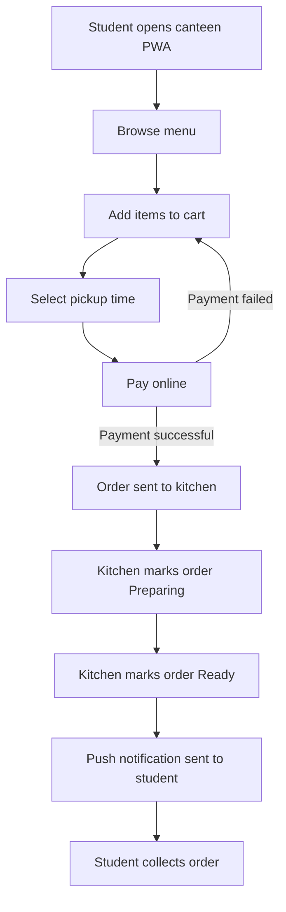

# Mobile and Web Applications Engineering: Online Canteen Food-Ordering System

**Name:** Thummala Sai Hasini
**USN:** NB25CSE387
**Assigned Case Study:** Question 2: Mobile and Web Applications Engineering

---

## 1. Introduction

Modern software is delivered to users in three main forms. A **mobile application** is installed on a phone and is built for a specific platform such as Android or iOS. A **web application** runs inside a browser and needs no installation, so it works on any device with internet access. A **Progressive Web Application (PWA)** is a web application that can be installed on the home screen, work offline or on weak networks, and send push notifications, while still being built with web technologies. Choosing the right form depends on the users, the features needed, and the development budget.

## 2. Problem Analysis

The college canteen currently takes orders at the counter. During peak hours, students queue for long periods, cash handling is slow, and staff have no way to plan how much food to prepare. The proposed online system must allow students to browse menus, place orders in advance, pay online, and receive a notification when their order is ready. The main users are students, canteen staff who prepare orders, and an administrator who manages menus and prices. The system must be easy to use on a phone, because most students will order from their mobile devices, while staff may use a counter computer.

## 3. Comparison of Mobile, Web, and PWA Approaches

| Criteria | Native Mobile App | Web Application | Progressive Web App |
|---|---|---|---|
| Installation | Downloaded from an app store | Not required; opened in a browser | Optional; added to the home screen from the browser |
| Development effort | Separate code for Android and iOS | One codebase | One codebase |
| Offline support | Full | Very limited | Good, using service workers and caching |
| Push notifications | Fully supported | Not supported | Supported (Android, and iOS 16.4 or later when added to the home screen) |
| Device hardware access | Full access | Limited | Moderate access |
| Updates | Users must update through the app store | Automatic | Automatic |
| Cost | High | Low | Low |

## 4. Proposed Solution: Progressive Web App

A Progressive Web App is the most suitable choice for the canteen system. The main reason is that students want to order quickly without downloading a new app from an app store, and a PWA can be opened from a link or a QR code placed at the canteen. A PWA also needs only one codebase, which keeps development and maintenance costs low for a college project. Push notifications allow the system to alert students when their food is ready, which is the most important feature for reducing waiting time. Offline caching allows the menu to load even on weak campus Wi-Fi.

A plain web application was rejected because it cannot send notifications or be installed. A native mobile app was rejected because it would require two separate codebases and app store approval, which is too costly for a canteen service. The PWA gives the best balance of accessibility, cost, and functionality.

## 5. Major Functionalities

**5.1 Menu Browsing.** Students can view food items organized by category, such as breakfast, snacks, meals, and beverages. Each item shows a photo, price, description, and whether it is vegetarian or non-vegetarian. Items that are out of stock are clearly marked.

**5.2 Order Placement.** Students can add items to a cart, change quantities, add special instructions, and select a pickup time slot. The system checks item availability before the order is confirmed, so students are not charged for items that cannot be prepared.

**5.3 Online Payment.** Students pay through a secure online payment gateway that supports UPI, debit cards, and net banking. The system does not store card details itself. The payment gateway returns a confirmation, and the order is sent to the kitchen only after successful payment.

**5.4 Order Status and Notifications.** Each order moves through clear stages: Received, Preparing, Ready for Pickup, and Collected. The student receives a push notification when the status changes to Ready. Students can also check the status at any time on the order screen.

## 6. Application Workflow Diagram

## 7. Benefits and Expected Results

The online canteen system is expected to reduce queue times at the counter, since students can order and pay before arriving. Kitchen staff can see orders in advance, which helps them prepare food more efficiently and reduce waste. Cash handling errors are reduced because payments are recorded electronically. Students benefit from easy access to the menu from any device, and the administrator can update prices and availability in real time. Because the PWA is installable and works on weak networks, students can use it throughout the campus.

## 8. Development Challenges

**8.1 Unreliable Network Connectivity.** Campus networks may be slow or disconnected during peak hours. The application must cache the menu using service workers so that it still loads, and it should clearly tell the user when an order cannot be placed because the connection has been lost. Payment cannot be completed offline, so the system must handle interrupted payments carefully to avoid double charges.

**8.2 Real-Time Status and Notification Reliability.** Order status must update immediately for both students and kitchen staff. This requires real-time communication, such as WebSockets or server-sent events. Push notifications also depend on the user granting permission, and iOS support is limited to PWAs added to the home screen. The system should provide an in-app status page as a fallback when notifications are not available.

**8.3 Payment Security and Integration.** Handling online payments requires strict security. The system should use a trusted payment gateway with hosted checkout pages so that card data never passes through the canteen's servers. The application must also handle failed, duplicate, or delayed transactions correctly, which requires careful use of unique order identifiers and payment status checks.

## 9. Conclusion

An online canteen food-ordering system can significantly reduce waiting time, improve kitchen planning, and make ordering easier for students. Among the mobile, web, and PWA approaches, a Progressive Web App offers the best balance of accessibility, low development cost, offline support, and push notifications. Its main functions are menu browsing, order placement, online payment, and real-time order status with notifications. Although connectivity, real-time updates, and payment security present challenges, these can be addressed with proper design and established technologies.
