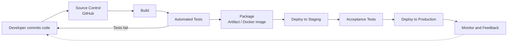

# DevOps Practices and CI/CD Pipelines

**Student Name:TRISHNA JENA
**USN:NB25CSE389
**Assigned Case Study:** Case Study 3 – DevOps Practices and CI/CD Pipelines

## 1. Introduction

**DevOps** is a set of practices that brings software **Dev**elopment and IT **Op**erations teams together so that software can be built, tested, and released faster and more reliably. Instead of developers "throwing code over the wall" to operations, both teams share responsibility for the whole lifecycle, supported by automation, monitoring, and continuous feedback.

Key DevOps ideas:

- **Collaboration** between developers, testers, and operations
- **Automation** of repetitive tasks such as building, testing, and deploying
- **Continuous improvement** based on monitoring and feedback
- **Version control** for all code and configuration

### Continuous Integration (CI)

Developers merge their code changes into a shared repository frequently (often several times a day). Each merge automatically triggers a build and a set of tests, so integration problems and bugs are found early.

### Continuous Delivery / Continuous Deployment (CD)
- **Continuous Delivery:** Every change that passes the automated tests is automatically prepared for release, but a human approves the final push to production.
- **Continuous Deployment:** Every change that passes all automated tests is released to production automatically, with no manual approval.

---

## 2. Problem Analysis

A software company develops an online shopping application. Developers frequently add new features and fix bugs, but the current process is manual:

| Problem | Impact |
| --- | --- |
| Manual testing of every change | Slow, and bugs are missed |
| Manual deployment to servers | Human errors, wrong configuration, downtime |
| Code integrated infrequently | Merge conflicts and late discovery of defects |
| No fast feedback to developers | Bugs are fixed late and cost more |
| Long release cycles | New features and fixes reach customers slowly |

The company needs an automated, repeatable process that delivers changes quickly without sacrificing quality.

## 3. Proposed Solution

Adopt DevOps practices and build a **CI/CD pipeline** that automatically takes every code change from commit to deployment.

### CI/CD Pipeline Diagram

### Pipeline Stages

1. **Source:** Developers push code to a shared Git repository (for example GitHub). A push or pull request triggers the pipeline.
2. **Build:** The pipeline compiles the code, resolves dependencies, and creates a runnable build. If the build fails, the developer is notified immediately.
3. **Test:** Automated tests run on every change:
   - Unit tests check individual functions (for example cart total calculation).
   - Integration tests check that modules work together (for example cart, payment, and order services).
   - Static analysis and security scans check code quality and vulnerabilities.
4. **Package:** The tested build is packaged as a versioned artifact or container image.
5. **Deploy to Staging:** The package is deployed to a production-like environment for further testing, such as end-to-end and acceptance tests.
6. **Deploy to Production:** After approval (Continuous Delivery) or automatically (Continuous Deployment), the release goes live. Strategies such as blue-green or rolling deployment reduce downtime.
7. **Monitor and Feedback:** Logs, performance metrics, and error reports are tracked. Problems feed back to developers for quick fixes or rollback.

### Explanation of Build, Test, and Deployment

| Phase | What happens | Example in the shopping application |
| --- | --- | --- |
| **Build** | Source code is compiled and packaged into a runnable form | Backend and frontend are built; a Docker image is created |
| **Test** | Automated tests verify correctness and quality | Tests check login, product search, cart, and payment flows |
| **Deployment** | The verified build is released to servers | New version is rolled out to the production site with no manual steps |

### Common Tools (Examples)

- **Version control:** Git, GitHub
- **CI/CD:** GitHub Actions, Jenkins, GitLab CI
- **Containers and orchestration:** Docker, Kubernetes
- **Monitoring:** Prometheus, Grafana

---

## 4. Benefits and Challenges

### Benefits of Automation

1. **Faster releases:** Features and bug fixes reach customers in hours or days instead of weeks.
2. **Higher quality:** Automated tests run on every change, so defects are caught early, when they are cheapest to fix.
3. **Fewer human errors:** Deployment is scripted and repeatable, which removes manual configuration mistakes and reduces downtime.

Additional benefits: quick rollback, better team collaboration, and more time for developers to build features rather than do manual testing.

### Challenges
   **Initial setup effort:** Building the pipeline and writing good automated tests takes time and skill.
- **Cultural change:** Teams must adopt shared ownership and new habits.
- **Tool and infrastructure cost:** CI/CD servers, test environments, and tool training have a cost.
- **Security:** Secrets, credentials, and pipeline access must be protected.

---

## 5. Conclusion

Manual testing and deployment cause delays and errors in the online shopping application. By applying DevOps practices and a CI/CD pipeline, the company can automate the build, test, and deployment stages so that every change is verified and released quickly and reliably. The result is faster delivery, better quality, and more confident releases, which makes the software process more efficient and customer-focused.
