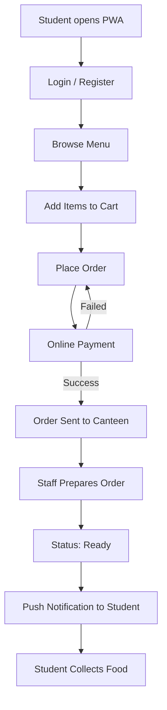

# Online Canteen Food-Ordering System

> A Progressive Web Application (PWA) that lets college students browse the canteen menu, place orders, pay online, and get notified when their food is ready.

**Student Name:** TUSHAR RAY
**USN:** NB25CSE390
**Case Study:** 2 – Mobile and Web Applications Engineering

---

## Table of Contents
1. [Introduction](#introduction)
2. [Problem Statement](#problem-statement)
3. [Mobile vs Web vs PWA](#mobile-vs-web-vs-pwa)
4. [Chosen Approach and Justification](#chosen-approach-and-justification)
5. [Major Functionalities](#major-functionalities)
6. [Application Workflow](#application-workflow)
7. [Proposed Tech Stack](#proposed-tech-stack)
8. [Project Structure](#project-structure)
9. [Getting Started](#getting-started)
10. [Development Challenges](#development-challenges)
11. [Future Enhancements](#future-enhancements)
12. [Conclusion](#conclusion)

---

## Introduction

Software applications that people use daily fall mainly into three categories:

- **Mobile applications** are installed from an app store and run natively on a device (Android or iOS).
- **Web applications** run in a browser and need no installation.
- **Progressive Web Applications (PWAs)** are web applications that behave like mobile apps. They can be installed on the home screen, work with poor connectivity, and send push notifications.

This project applies these ideas to a real campus problem: ordering food from the college canteen.

## Problem Statement

Students currently queue at the canteen counter, which wastes break time. Orders are taken manually, so mistakes happen, payments are slow, and students don't know when their food is ready.

The college needs an online system that allows students to:
- Browse the menu and see availability
- Place orders from anywhere on campus
- Pay online
- Receive a notification when the order is ready

## Mobile vs Web vs PWA

| Criteria | Native Mobile App | Web App | PWA |
|---|---|---|---|
| Installation | App store download | None (open in browser) | Optional "Add to Home Screen" |
| Platforms | Separate Android and iOS builds | All devices with a browser | All devices with a modern browser |
| Development cost | High (multiple codebases) | Low (single codebase) | Low (single codebase) |
| Updates | User must update | Instant | Instant |
| Push notifications | Yes | Limited | Yes |
| Offline support | Yes | Minimal | Yes (via service workers) |
| Device features | Full access | Limited | Partial |
| Maintenance effort | High | Low | Low |

## Chosen Approach and Justification

**Selected: Progressive Web Application (PWA)**

1. **One codebase for all students.** Students use different phones and laptops, and a single PWA works on all of them.
2. **No installation barrier.** Students open a link or scan a QR code at the canteen. No store approval or storage space is needed.
3. **Push notifications.** The "your order is ready" alert is a core requirement, and PWAs support it.
4. **Low cost.** One team can build and maintain it, which suits a college project.
5. **Instant updates.** Menu and price changes reach every user immediately.
6. **Works on weak networks.** Cached menus keep the app usable on patchy campus Wi-Fi.

## Major Functionalities

### 1. User Registration and Login
Students sign up with their college email or USN and log in securely. The canteen staff have a separate admin login.

### 2. Menu Browsing
Students view categories (breakfast, lunch, snacks, beverages), prices, images, and availability. Items can be searched and filtered.

### 3. Cart and Order Placement
Students add items to a cart, adjust quantities, choose a pickup time, and confirm the order.

### 4. Online Payment
Payment is supported through UPI, cards, or wallet through a payment gateway. Students get a digital receipt.

### 5. Order Tracking and Notifications
Order status moves through **Placed → Preparing → Ready → Collected**. A push notification is sent when the order is ready.

### 6. Admin Dashboard (Canteen Staff)
Staff manage the menu, update stock, view incoming orders, and update order status.

## Application Workflow



## Proposed Tech Stack

| Layer | Technology |
|---|---|
| Frontend | HTML, CSS, JavaScript (React) |
| PWA features | Service Worker, Web App Manifest, Push API |
| Backend | Node.js with Express |
| Database | MongoDB (or MySQL) |
| Payments | Razorpay / UPI gateway |
| Hosting | Any cloud platform (e.g. Render, Vercel) over HTTPS |

## Project Structure

```
canteen-app/
├── client/                # Frontend (React PWA)
│   ├── public/
│   │   ├── manifest.json
│   │   └── service-worker.js
│   └── src/
├── server/                # Backend (Node.js + Express)
│   ├── routes/
│   ├── models/
│   └── controllers/
├── .env.example
└── README.md
```

## Getting Started

> These steps describe the proposed setup for the project.

**Prerequisites:** Node.js (v18+), npm, and a MongoDB instance.

```bash
# 1. Clone the repository
git clone https://github.com/<your-username>/canteen-app.git
cd canteen-app

# 2. Install dependencies
cd server && npm install
cd ../client && npm install

# 3. Configure environment variables
cp .env.example .env

# 4. Run the backend
cd server && npm start

# 5. Run the frontend
cd client && npm start
```

Open `http://localhost:3000` in your browser.

## Development Challenges

1. **Reliable push notifications.** Browser support and permission handling vary, so a fallback such as an in-app alert or SMS may be needed.
2. **Secure payment integration.** The system must handle payment failures, refunds, and duplicate orders safely, and never store card details.
3. **Peak-hour load.** Many students order at the same break time. The backend must scale, and stock must update in real time to avoid selling unavailable items.

## Future Enhancements

- Order history and "reorder" feature
- Ratings and reviews for menu items
- Pre-order for next-day meals
- Loyalty points and discounts
- Analytics for canteen staff on popular items

## Conclusion

A PWA is the most suitable choice for the college canteen system. It combines the reach of a web app with the notifications and installability of a mobile app, at a lower development and maintenance cost. It reduces queues, speeds up ordering, and gives students a smoother experience.

---

**Author:** TUSHAR RAY (NB25CSE390)
