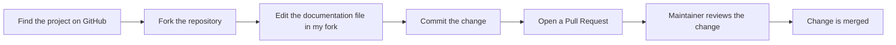

# Open-Source Software Engineering — Improving Documentation for a Library Management System

**Name:** Vivek Kumar
**USN:** NB25CSE409
**Section:** CSE F
**Assigned Case Study:** Question 4 — Open-Source Software Engineering

## 1. Introduction

Open-source software is software whose code is open for anyone to see, use, and improve. It is not built by one company alone. It is built by many people working together on the internet, usually on a platform like GitHub.

Open-source software engineering is the way this kind of work is done. People do not just write code on their own computers and send it to someone. They follow a fixed process: they copy the project, make their change in their own copy, and then ask the project owners to accept that change. This process keeps the main project safe, even when many strangers are contributing to it.

In this case study, I look at one small but common problem: a Library Management System is available as open-source code, but its documentation is incomplete. It does not clearly explain how a user can issue and return books. My contribution is to fix that documentation.

## 2. Problem Analysis

The Library Management System is hosted on GitHub. The code for issuing and returning books is already there, but the documentation does not explain how to use it.

This creates three clear problems:

1. **New users get confused.** A student or librarian who opens the project does not know the steps to issue a book, return a book, or check if a book is available.
2. **People make mistakes.** Without clear steps, users may issue the same book twice, or return a book without updating the record.
3. **The project gets fewer users.** If people cannot understand a project in the first few minutes, they usually leave it and look for another one. Good code with poor documentation is hard to use.

The problem is not in the code. The problem is in the explanation. So the fix needed here is not a new feature. It is better documentation.

## 3. Proposed Solution

My solution is to add a clear documentation file that explains issuing and returning books in simple steps. I will do this through the normal GitHub contribution process, so the change can be checked by the maintainers before it is added to the main project.

### What the documentation will contain

I will create or update a file like `docs/issuing-and-returning-books.md` with:

- **How to issue a book:** search for the book, check if it is available, select the member, confirm the issue, and note the due date.
- **How to return a book:** search for the issued book, mark it as returned, check if it is late, and update the book as available again.
- **What to do in special cases:** what happens if a book is already issued, if a member has reached the limit, or if a book is returned late.
- **One short example:** a member issues one book on Monday and returns it on Friday, with the record updated at each step.

The language will be simple and the steps will be numbered, so even a first-time user can follow them without asking for help.

### How to contribute — the GitHub workflow

1. **Find the project.** Open the Library Management System repository on GitHub and read its README file to understand what the project does and how to contribute.
2. **Fork the repository.** Click Fork. This creates my own copy of the project under my GitHub account. My changes will not affect the original project at this stage.
3. **Create or edit the documentation file.** In my fork, I will add the new documentation file and write the steps for issuing and returning books.
4. **Commit the change.** I will commit the file to my fork with a clear message, for example: `Added documentation for issuing and returning books`.
5. **Open a Pull Request.** From my fork, I will open a Pull Request to the original repository. I will write a short description of what I changed and why it is needed.
6. **Review and merge.** The maintainers will read the change, suggest corrections if needed, and merge it into the main project once it is correct.

This is the same process I am following for this SEA activity: fork the faculty repository, add my file in the `contributions` folder, commit it, and submit a Pull Request.

## 4. GitHub Contribution Workflow

## 5. Benefits and Challenges

### Benefits

- **The project becomes easier to use.** Clear steps mean new users do not need to guess or ask the developers for help.
- **Many people can improve it together.** One person fixes the documentation, another person fixes a bug, and the project keeps improving without one person doing everything.
- **Contributors learn real software work.** Working with forks, commits, and Pull Requests is how real software teams work. It is useful experience beyond the classroom.
- **The main project stays safe.** Because changes are reviewed before merging, a wrong change in one person's copy does not break the project for everyone.

### Challenges

- **The Pull Request may be rejected or changed.** The maintainers may ask for corrections, or they may say the documentation needs to be written differently. That is normal, and it means the change has to be updated and submitted again.
- **The project may change after I fork it.** If the maintainers update the main project while I am working, my copy can become old, and I may have to update it before my Pull Request can be merged.
- **There may be no clear contribution rules.** Some small projects do not have a proper guide for contributors, so a new contributor has to guess the file format and style they should follow.

## 6. Conclusion

Open-source software works because people contribute small, useful changes and those changes are checked before they are accepted. In this case study, the Library Management System did not need new code. It needed clear documentation for issuing and returning books.

By forking the repository, adding a simple step-by-step documentation file, committing the change, and submitting a Pull Request, a student can make the project easier for every future user. That is the main idea of open-source software engineering: many small contributions, done in the open, make a project better for everyone.
