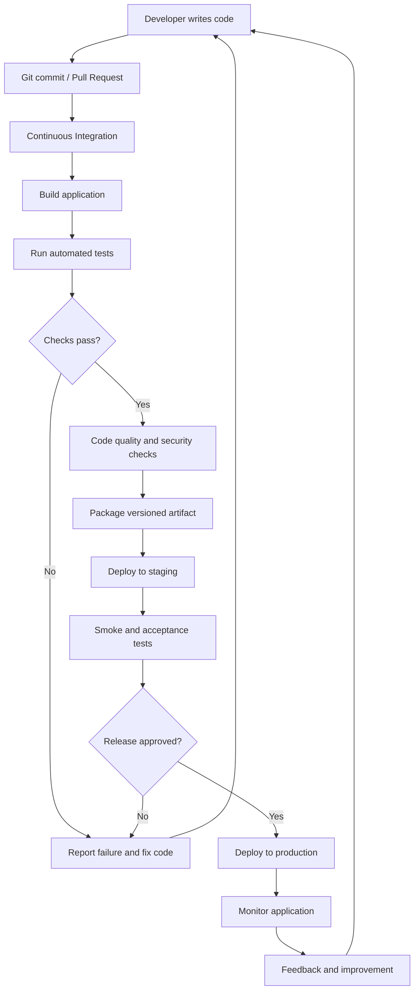

# DevOps Practices and CI/CD Pipelines for an Online Shopping Application

**Student Name:** VARSHITH Y  
**USN:** NB25CSE418  
**Case Study:** 3 – DevOps Practices and CI/CD Pipelines

## 1. Introduction

DevOps is a set of practices that brings software development (Dev) and IT operations (Ops) teams together to deliver software faster, more reliably, and continuously. It encourages collaboration, automation, continuous feedback, and shared responsibility throughout the software development lifecycle.

For an online shopping application, DevOps helps teams release new features such as product search, shopping carts, payment options, order tracking, and offers while maintaining application stability, security, and availability. Since customers expect the application to work at all times—especially during sales and peak shopping periods—automated build, test, and deployment processes are important.

## 2. Problem Analysis

In a traditional software delivery process, developers may complete features independently and hand them over to an operations team for deployment. This can create several problems:

- **Slow releases:** Manual builds, testing, and deployments delay the delivery of new features and bug fixes.
- **Integration issues:** Code developed by different team members may not work together when combined late in the project.
- **Human errors:** Manual configuration and deployment steps can cause incorrect settings, failed releases, or downtime.
- **Insufficient testing:** Limited or inconsistent testing can allow defects to reach production.
- **Difficult recovery:** Without automated rollback and monitoring, recovering from a failed release can take longer.

For an online shopping application, these problems may interrupt browsing, checkout, payments, or order processing and can reduce customer trust.

## 3. Proposed Solution: DevOps and CI/CD

The proposed solution is to adopt DevOps practices and implement an automated Continuous Integration and Continuous Delivery/Deployment (CI/CD) pipeline.

### 3.1 Continuous Integration (CI)

Continuous Integration is the practice of frequently merging developers' code changes into a shared repository. Whenever code is pushed or a pull request is created, an automated pipeline can:

1. Retrieve the latest source code from the repository.
2. Install dependencies and compile/build the application.
3. Run automated unit and integration tests.
4. Perform code-quality and security checks.
5. Report the results so that defects can be fixed early.

CI helps detect integration problems quickly rather than waiting until the end of development.

### 3.2 Continuous Delivery vs. Continuous Deployment

Both practices automate the steps after Continuous Integration, but they differ in the final release decision.

| Aspect | Continuous Delivery | Continuous Deployment |
|---|---|---|
| Meaning | Keeps every validated change ready for release | Automatically releases every validated change to production |
| Production release | Requires a manual approval or release decision | Happens automatically when all checks pass |
| Control | Provides a human checkpoint before production | Minimizes manual intervention |
| Suitability | Useful when releases require business or compliance approval | Useful when the team has strong automated testing and monitoring |

For the online shopping application, Continuous Delivery can be used initially so that a team member approves production releases. Continuous Deployment can be adopted later when the application has reliable automated tests, monitoring, and rollback mechanisms.

### 3.3 Stages of the CI/CD Pipeline

1. **Plan and Code:** Developers plan features and write code using version control such as Git.
2. **Commit and Integrate:** Developers push changes or open pull requests in a shared repository.
3. **Build:** The pipeline installs dependencies and creates a deployable application package.
4. **Test:** Automated unit, integration, API, and end-to-end tests verify the application.
5. **Quality and Security Checks:** Static code analysis, dependency scanning, and configuration checks identify potential issues.
6. **Package and Store:** A versioned build or container image is created and stored in an artifact or container registry.
7. **Deploy to Staging:** The build is deployed to a staging environment that resembles production.
8. **Approval and Production Deployment:** After validation and, for Continuous Delivery, approval, the release is deployed to production.
9. **Monitor and Feedback:** Logs, metrics, alerts, and user feedback are monitored. Problems are used to improve the next development cycle.

### 3.4 Build, Test, and Deployment Process

- **Build:** A CI server such as GitHub Actions can automatically install project dependencies and compile/package the application whenever code is pushed.
- **Test:** Automated tests check important shopping workflows, including user login, product listing, cart updates, checkout, and order creation. Tests should also validate payment integration using a safe test environment rather than real transactions.
- **Deployment:** A successful build is first deployed to staging. After smoke tests and any required approval, the same versioned artifact is deployed to production. Blue-green or rolling deployments can reduce downtime.
- **Rollback:** If monitoring detects a serious issue, the team can restore the previous stable version.
- **Monitoring:** Application health, response time, error rates, checkout failures, and infrastructure usage are monitored so the team can respond quickly.

### 3.5 CI/CD Pipeline Diagram

## 4. Benefits of DevOps and CI/CD

1. **Faster and more frequent releases:** Automation reduces manual effort and allows the team to deliver new shopping features and fixes more quickly.
2. **Improved software quality and reliability:** Automated tests and quality checks identify defects early, reducing the chance of faulty code reaching customers.
3. **Better collaboration and recovery:** Shared workflows improve communication between development and operations teams. Monitoring and rollback practices help reduce the impact of deployment failures.

## 5. Challenges and Mitigation

- **Initial setup effort:** Creating pipelines and automated tests takes time. Start with essential build and test stages, then expand gradually.
- **Test maintenance:** Tests can become outdated as features change. Keep tests modular and update them as part of normal development.
- **Security of credentials:** Store deployment keys and API secrets in a secure secrets manager or CI platform secrets; never commit them to source control.
- **Production risk:** Use staging, approvals, health checks, gradual releases, monitoring, and rollback procedures to control deployment risk.
- **Team learning:** Provide documentation and training so developers and operations staff understand the pipeline and share responsibility.

## 6. Conclusion

DevOps and CI/CD provide a systematic way to build, test, release, and monitor an online shopping application. Continuous Integration detects integration problems early, while Continuous Delivery or Continuous Deployment makes validated changes available to users in a controlled and repeatable manner. By automating builds and tests, monitoring production, and preparing rollback procedures, the team can release features faster while maintaining application quality, reliability, and customer confidence.
